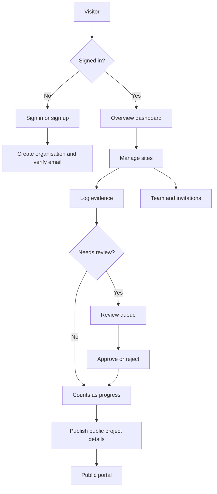

# User flows and lifecycle

## 1. High-level flow

## 2. New user onboarding

### Sign-up path

1. User lands on public home or sign-up flow.
2. User enters their name, email, password, and organisation name.
3. A new `User` is created in inactive state.
4. A new `Organisation` is created.
5. The user is assigned the `admin` role in the organisation.
6. Email verification is sent.
7. After verification, the user can sign in and begin using the app.

This creates a self-serve “first admin” process for new organisations.

## 3. Internal app flow: overview and sites

After sign-in, the app redirects to the overview dashboard.

The overview view computes:

- how many sites are in each status bucket
- stale/out-of-date sites based on `stale_after_days`
- attention items requiring follow-up

From there the user can:

- open the sites list
- create a new site
- edit an existing site
- view evidence and milestone status for a site

## 4. Site lifecycle

The site flow is the central business process.

### Create site

The `site_create` view:

- checks current organisation membership
- validates `EDIT_SITES` permission
- saves a new site for the current organisation
- optionally auto-publishes if the org is verified and configured to do so
- records an audit event

### Edit site

The `site_edit` flow behaves like a normal update, with audit metadata tracking which fields changed.

## 5. Evidence logging flow

Evidence is logged from a site detail page or evidence creation form.

### Evidence creation

The system records:

- who authored the entry
- which site it belongs to
- the kind of evidence
- body text and tags
- capture time/location
- whether it is on site or near site
- whether it must go to review

### Verification checks

Evidence entries compute:

- geospatial distance to the site
- whether location is within the site boundary or near the site
- a content hash for integrity
- a chain to the previous record for the same site

This makes the evidence trail auditable and difficult to tamper with.

## 6. Review and approval flow

Evidence created by roles that require review moves into the review queue.

The review flow:

- review team sees pending items
- reviewer approves or rejects the evidence
- a `EvidenceReview` object is created with decision details
- only approved or non-review evidence counts toward the project record

This is how the app separates transparency from operational review without blocking the whole workflow.

## 7. Team and role management

Organisation administrators manage staff and membership through the team interface.

### Invite flow

- admin creates an invitation from the team screen
- system sends an email link to the invited person
- invite has an expiry window
- accepted invite creates a `Membership`
- role is assigned according to the invite

### Role changes

Admins can change a member role or remove a member, with protections to prevent the organisation from being left without an admin.

## 8. Public project visibility flow

Verified organisations can publish site/project data to the public portal.

This flow includes:

- site has `is_public = True`
- organisation verification status is `VERIFIED`
- public pages show project details without exposing private admin functions

This is designed for stakeholder communication and customer-facing progress reporting without revealing the internal system.

## 9. Audit trail flow

Many user actions are recorded as immutable events.

Examples include:

- site created
- site edited
- member invited
- member removed
- role changed
- review decision made
- evidence amended

These records help explain what happened and who did it, even in complex operational workflows.

## 10. Typical end-to-end operational flow

A common operational cycle looks like this:

1. Admin creates organisation and team.
2. Admin creates sites and sets status.
3. Field staff log site evidence and photos.
4. Contractor or field entries may enter review queue.
5. Editor or admin approves or rejects evidence.
6. Site progress updates and public project summaries reflect the reviewed data.
7. Audit history continues to track all changes and approvals.

This is the operational core of the product: evidence becomes trustworthy, reviewable, and visible over time.
